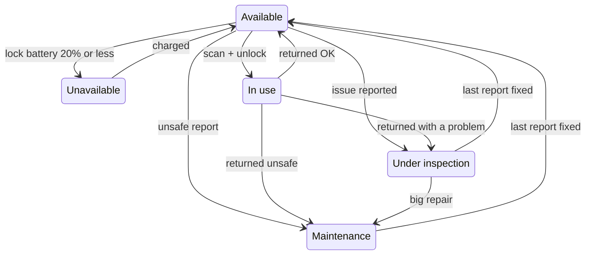

# PedalPass System Documentation

Last updated: Nov 10, 2026 · Online version (editable, with comments): https://claude.ai/artifact/LosEfz5oi3BSmN7E2xxvku

## Overview

PedalPass is DYCI's campus bike-sharing system: riders unlock a bike by scanning its QR code in the mobile app, and admins run the fleet from a web portal. Both apps share one Supabase database. There is one station, the Covered Court Hub at the Elida Campus Covered Court beside Bldg. B.

| Who | Account role | Uses | What they do |
| --- | --- | --- | --- |
| Students | user (member type: student) | Mobile app (Expo Go) | Sign up, pass the identity check, borrow and return bikes, report problems |
| Faculty and staff | user (member type: faculty) | Mobile app (Expo Go) | Same as students; only an ID photo is needed for the identity check |
| Admins | admin | Web portal (browser) | Approve riders, handle reports, manage bikes and QR codes, watch rides and SOS alerts |

Maintenance personnel have no account. The admin contacts them outside the app, and records the repair in the portal when they say a bike is fixed.

## Setup

One Supabase project serves both apps. Run each SQL file once, in order, in Supabase → SQL Editor → New query → paste the whole file → Run.

| Order | File | What it adds |
| --- | --- | --- |
| 1 | supabase/schema.sql | Tables, security rules, starter bikes and station |
| 2 | migrations/002_identity_verification.sql | Identity check: ID, COR and selfie upload, admin approval |
| 3 | migrations/003_unlock_tokens.sql | Smart-lock keys and signed unlock tokens; cancel a failed unlock |
| 4 | migrations/004_privacy_and_reports.sql | Only admins see rider data; reports filled in by the database |
| 5 | migrations/005_live_data.sql | Removes sample tickets; adds repair notes |
| 6 | migrations/006_covered_court_station.sql | The one real station: Covered Court Hub |
| 7 | migrations/007_user_and_admin_roles.sql | Roles reduced to user and admin |
| 8 | migrations/008_faculty_id_only.sql | Faculty and staff upload only their ID |
| 9 | migrations/009_under_inspection_status.sql | New bike status Under Inspection (must run on its own, before 010) |
| 10 | migrations/010_automation_and_history.sql | Automatic statuses, activity log, QR secret codes, swaps |
| 11 | migrations/011_remove_bike.sql | Remove or retire bikes; 20% battery or lower = Unavailable |

To check which ones already ran, see the query in Troubleshooting.

**Keys.** Copy the Project URL (Connect button) and the Publishable key (Project Settings → API Keys) into:

- mobile/.env.local (copy mobile/.env.example)
- web/.env (copy web/.env.example)

These files are not on GitHub on purpose. Each computer needs its own copy.

**Verification emails.** Sign-up sends a 6-digit code from a Gmail account:

1. On the Gmail account, turn on 2-Step Verification and create an App Password named PedalPass.
2. Supabase → Authentication → Emails → SMTP Settings: host smtp.gmail.com, port 587, username and sender = the Gmail address, password = the App Password, sender name PedalPass.
3. Templates → Confirm signup: paste supabase/email-templates/confirm-signup.html.
4. Sign In / Providers → Email: Confirm email ON, Email OTP Length 6.

First emails often land in Spam. Free Supabase projects pause after about a week without use, so open the dashboard before a demo.

## Running the apps

Both apps need Node.js LTS (nodejs.org) and run from a terminal; in VS Code, open one from the Terminal menu → New Terminal. Run `npm install` once per computer in each app folder before the first start.

**Admin web portal**

```
cd C:\Users\Eliza\Downloads\pedalpass\pedalpass\web
npm run dev
```

Open http://localhost:3000 in Chrome and sign in with an admin account. Keep the terminal open; closing it stops the site, and the browser then shows "localhost refused to connect". Others on the same Wi-Fi can use the Network address the terminal prints. To publish it online, run `npm run build` and upload the web/dist folder to Netlify, Vercel or Firebase Hosting.

**Mobile app**

```
cd C:\Users\Eliza\Downloads\pedalpass\pedalpass\mobile
npx expo start -c
```

1. Install Expo Go from the Play Store or App Store.
2. Scan the QR code shown in the terminal (iPhone: with the Camera app).
3. The phone and the laptop must be on the same Wi-Fi. If school Wi-Fi blocks it, use `npm run tunnel` instead.

The `-c` clears Expo's cache; use it after changing app.json. Saving a code file reloads the app on the phone, and pressing r in the terminal reloads it by hand. Expo Go cannot use Bluetooth, so the smart lock is simulated until a development build is made.

## Admin accounts

Admin accounts are made in the Supabase dashboard, never in the mobile app. Only accounts with role admin can sign in to the web portal.

**Create a new admin**

1. Supabase → Authentication → Users → Add user → Create new user. Enter the email and a password, and tick Auto Confirm User.
2. In the SQL Editor, run (with that email):

```sql
update profiles
set role = 'admin', verification_status = 'approved', is_verified = true
where email = 'new-admin@example.com';
```

**Find the existing admins**

```sql
select email, name, created_at from profiles where role = 'admin';
```

**Reset a forgotten admin password**

```sql
update auth.users
set encrypted_password = extensions.crypt('NewPassword123', extensions.gen_salt('bf'))
where email = 'admin@example.com';
```

Or open the user in Authentication → Users and choose Send password recovery; that only helps if you can open the inbox. Keep admin passwords in a password manager or a shared, private group note.

## Admin portal guide

Every page is in the left sidebar. The bell in the top bar opens Fleet & Security and shows a dot while an SOS alert is open; your name at the top right has Sign out.

| Page | What it shows | What you do there |
| --- | --- | --- |
| Dashboard | Rides in 30 days with the change vs the 30 days before, bikes ready, most used bikes, rides per day, reports, riders, fleet overview | Check the system at a glance; each card links to its page |
| Reports | Every problem reported, open and fixed, with search, priority filter and Export | Set a report to Sent to maintenance after contacting them; press Mark as fixed when they say it is done |
| Maintenance | The bikes that need work now: on hold, with open reports, or lock battery under 30%; most urgent first | Open a bike's reports, or Make available for a bike on hold with no open report; Export |
| Bikes | Every bike with lock ID, battery, status and lock | Add bike (makes its QR code), Remove, History (riders with View rider and ID photo, reports, swaps) |
| Approvals | Riders waiting for the identity check, each with a recommendation and reasons | Compare selfie with ID; approve or reject one by one, or tick several and use Approve selected / Reject selected |
| Analytics | Recommendations, comparison numbers, fleet status, rides per day/week/month vs the period before, rides by hour and weekday, most used bikes, problems by part, maintenance priority, recurring problems | Plan repairs and charging for quiet hours; Export usage |
| Fleet & Security | Riders out now (late ones marked after 45 minutes) and open SOS alerts | Follow up late riders; Mark as handled on an alert |
| QR Codes | Every bike's current QR code | Download, Print all, or Regenerate a damaged or lost code (the old one stops working at once) |
| Activity Log | Everything that happened: rides, returns, reports, repairs, approvals, QR changes, removals | Filter by date, type, bike or text; Export |

**Mark as fixed.** Type who fixed the bike and what was done, tick that maintenance confirmed it is safe, then save. The bike becomes Available by itself once it has no other open report.

**Add bike.** The form suggests the next code (for example BP-011), lock ID and bay. Bike codes must look like BP-001, because that is what the scanner reads. Save shows the new QR code to download or print.

## Mobile app guide

The bottom bar is Home · My Rides · Scan (gold, middle) · Map · Profile. A rider can borrow only after an admin approves their identity.

**Sign up**

1. Choose Student or Faculty/Staff and fill in the form. Students can scan their COR to fill it in automatically.
2. Students add their school ID, COR and a selfie; the selfie is matched with the ID photo on the phone. Faculty and staff add only their ID.
3. Agree to the Data Privacy notice, then enter the 6-digit code sent by email.
4. Wait for an admin to approve the account. Until then the app shows the identity screen.

**Borrow a bike**

1. Go to the Covered Court Hub and tap Scan. Point the camera at the QR code on the bike.
2. The app checks the account, that no other ride is open, that the bike is available, and that its lock battery is above 20%.
3. Tap Unlock Bicycle Now. The inspection checklist opens: mark Brakes, Tires, Chain and Overall condition as OK or Problem.
4. All OK → Looks good — Unlock. A problem → add a note, tick Unsafe to ride if it is, then Report & Choose Another Bike, or Report & Ride Anyway (hidden when unsafe).

**During the ride**

- My Rides shows the ride in progress with a live timer; Open ride shows End Ride, SOS and Swap Bike.
- The limit is 45 minutes; the timer card warns when it is passed.
- SOS alerts campus security in the admin portal; Call Local 104 is on the same screen.
- Swap Bike: pick what is wrong, lock the bike at the station, then scan another one. The ride continues on the new bike and the old one is reported.

**Return the bike**

1. Park it at its bay and tap End Ride.
2. The checklist opens again. Any problem is sent to the admin as a report when the ride ends; if sending fails, the app offers Try again.
3. The ride appears under My Rides with its time and receipt.

There is no separate Report Issue screen: riders report problems through the two checklists and Swap Bike.

## How the system decides things

The database sets every bike's status itself from what happens to it; admins never type a status. A bike can be borrowed only while it is Available.



Any problem reported on an available bike puts it on hold (an unsafe report sends it straight to Maintenance), and a return with a problem does the same. It goes back to Available only when the admin marks its last open report fixed, or uses Make available when no report is open.

- **Battery:** at 20% lock battery or lower a bike shows Unavailable and cannot start a ride; above 20% it is Available again.
- **Reports:** New (maintenance not contacted yet) → Sent to maintenance → Fixed. Big repair keeps the bike in Maintenance until it is fixed.
- **Unsafe reports:** a rider's "unsafe to ride" report counts as top priority only if they rode that bike in the last hour; otherwise it is kept as medium priority for checking.
- **QR codes:** each QR holds the bike code plus a secret part. A ride starts only with the current code, so a regenerated or removed bike's old sticker stops working.
- **Swap:** the old ride ends, the old bike gets a report and goes Under inspection, and the new bike starts in the same step; if the new bike can't be started, nothing changes.
- **Removing a bike:** a bike never used is deleted; one with rides or reports is retired, hidden from both apps, with its history kept.
- **Activity log:** every ride, return, report, repair, approval, QR change and removal is written automatically and cannot be edited.

## Data privacy

Rider data is handled under the Data Privacy Act of 2012 (RA 10173): only admins can see riders' profiles and photos, and photos are kept no longer than needed. Riders agree to this in the consent text at sign-up.

| Data | Kept | Who can see it |
| --- | --- | --- |
| Selfie | Deleted when an admin approves or rejects the rider | The rider and admins, until then |
| COR photo | Deleted when an admin approves or rejects the rider | The rider and admins, until then |
| ID photo | Kept while the rider has an account, so admins can identify who rode a bike; deleted on rejection | Admins (Bike History → View rider), through a link that expires after 10 minutes |
| Profile (name, email, student number, course or department) | While the account exists | The rider and admins |
| Rides, reports, swaps, activity log | Kept for history, also after a bike is removed | Riders see their own rides; admins see everything |

Photos sit in a private storage bucket, and riders cannot replace them while an admin is reviewing. Deleting an account does not yet delete its ID photo: remove the rider's folder in Supabase → Storage → verification as well.

## Troubleshooting

| Problem | Cause | Fix |
| --- | --- | --- |
| Browser says "localhost refused to connect" | The web portal is not running | Run npm run dev in the web folder and keep that terminal open |
| Bikes list or Dashboard does not load | Migration 011 not run (column retired_at missing) | Run 011_remove_bike.sql in the SQL Editor |
| SQL error: schema "private" does not exist | Migration 003 never ran | Run the missing migrations in order, then 010 again |
| Old printed QR says "Old QR code" or "no longer valid" | QR codes now carry a secret part, or the code was regenerated | Print the current code from QR Codes |
| Bike shows Unavailable | Lock battery is 20% or lower | Charge the lock; it becomes Available again above 20% |
| Bike stays Under Inspection after a repair | It still has another open report | Mark that report fixed too, or use Make available when no report is open |
| Can't sign in to the portal | Account is not an admin, or the password is forgotten | See Admin accounts |
| Verification code email never arrives | SMTP not set, or the email is in Spam | Check Setup → Verification emails; check Spam |
| Expo Go can't connect | Phone and laptop on different networks, or school Wi-Fi blocks it | Same Wi-Fi, or run npm run tunnel |
| Supabase is slow or stopped | Free project paused after a week of no use | Open the Supabase dashboard and restore it |

**Which migrations already ran?** Paste this in the SQL Editor; every column should say true:

```sql
select
  exists (select 1 from information_schema.columns where table_name = 'profiles' and column_name = 'verification_status') as "002",
  exists (select 1 from pg_namespace where nspname = 'private') as "003",
  exists (select 1 from pg_proc where proname = 'can_review_identity') as "004",
  exists (select 1 from information_schema.columns where table_name = 'work_orders' and column_name = 'resolution_notes') as "005",
  exists (select 1 from stations where id = 'st-cc') as "006",
  exists (select 1 from information_schema.columns where table_name = 'profiles' and column_name = 'member_type') as "007",
  exists (select 1 from pg_enum where enumlabel = 'inspection') as "009",
  exists (select 1 from information_schema.tables where table_name = 'activity_log') as "010",
  exists (select 1 from information_schema.columns where table_name = 'bikes' and column_name = 'retired_at') as "011";
```

## Project files and GitHub

The code is in the private repository [Xett0120/pedalpass](https://github.com/Xett0120/pedalpass). The latest work is on the branch improvements-admin-mobile, not yet merged into main.

| Folder | What is in it |
| --- | --- |
| mobile/ | Student and faculty app (Expo, React Native). Screens in src/screens, shared parts in src/components, colours in src/theme.ts, database calls in src/services |
| web/ | Admin portal (React, Vite, Tailwind). Pages in src/components, data and rules in src/lib, colours in src/index.css |
| supabase/ | schema.sql, migrations/ (run in order), email template, the scan-cor function |
| docs/ | This documentation |
| test-qr-codes/ | Old test QR images; they no longer work since migration 010 |
| README.md | Short setup notes |

**Getting the latest code on another computer**

```
git clone https://github.com/Xett0120/pedalpass.git
cd pedalpass
git switch improvements-admin-mobile
```

Then create mobile/.env.local and web/.env from the .env.example files, and run npm install in both app folders.

**Merging into main.** On GitHub open the branch, choose Compare & pull request, then Merge pull request. After that, everyone can use main again.

**Not finished yet.** The real Bluetooth smart lock (Expo Go can't use Bluetooth; a development build is needed), the location check at the station, and deleting a rider's ID photo automatically when their account is deleted.
