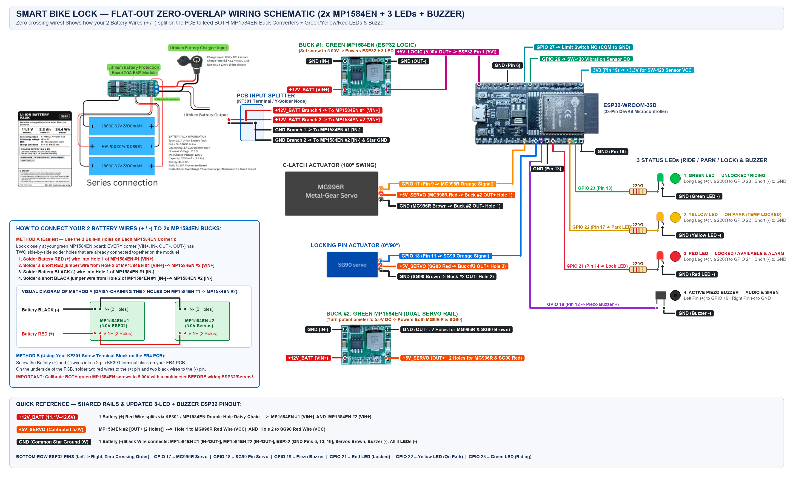
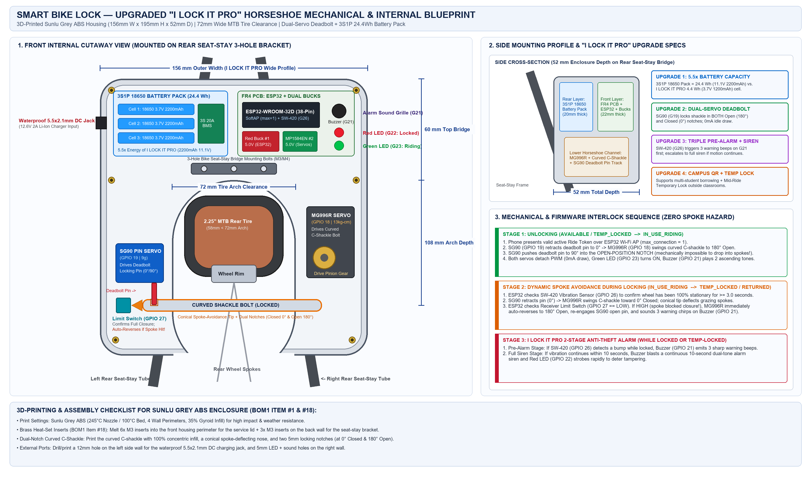

# Milestone 1: Smart Bike Lock Wiring Schematic & FR4 PCB Pinout (Matched to Your Canva Board)

> [!IMPORTANT]
> **Audit of Your Assembled 3S1P Battery Pack on Canva (`https://canva.link/53c41j7v3p0acd1`)**
> * **Verdict: 100% Electrically Correct!** Your 3S1P series cell wiring (`0V` $\rightarrow$ Cell 1 `-`, `4.2V` $\rightarrow$ Cell 1 `+` / Cell 2 `-`, `8.4V` $\rightarrow$ Cell 2 `+` / Cell 3 `-`, `12.6V` $\rightarrow$ Cell 3 `+`), the `5.5 x 2.1 mm` charging jack, and the `KF301` screw terminal block on the `3S 20A BMS` output (`Lithium Battery: Output` Red `+` / Black `-`) are wired properly.
> * **Critical Pre-Power Step:** Before connecting your `MG996R` and `SG90` servos to the **Green `MP1584EN` Buck Converter**, power the board from your assembled 3S battery pack and turn the small silver potentiometer screw on the bottom-right of the Green `MP1584EN` until a multimeter across `OUT+` and `OUT-` reads **$5.00\text{V}\text{–}5.20\text{V}$ DC**. (The **Red USB Buck Converter** on the left is already factory-fixed at **$5.00\text{V}$ DC** for the ESP32).

---

## 1. Flat-Out Zero-Overlap Wiring Schematic (2x `MP1584EN` + 3 Status LEDs + Buzzer)

To prevent any confusing wire crossovers, the primary schematic below lays out every module flat in its own zone. **No two wires cross or overlap anywhere:**
* **How Your 2 Battery Wires (`+` / `-`) Connect to Both `MP1584EN` Buck Converters:** Every corner of the green `MP1584EN` module (`VIN+`, `IN-`, `OUT+`, `OUT-`) has **two side-by-side connected solder holes**. Solder the Battery **Red (`+`)** wire into **Hole 1 of `MP1584EN #1 [VIN+]`** and run a short red jumper wire from **Hole 2 of `MP1584EN #1 [VIN+]`** to **`MP1584EN #2 [VIN+]`** (do the exact same for the Battery **Black (`-`)** wire on `IN-`, or split them inside a `KF301` screw terminal block on your FR4 PCB).
* **Direct Non-Crossing Bottom-Row ESP32 Pin Order (Left $\rightarrow$ Right):**
  * **`GPIO 17` (Pin 9)** $\rightarrow$ `MG996R` C-Latch Servo Signal
  * **`GPIO 18` (Pin 11)** $\rightarrow$ `SG90` Locking Pin Servo Signal
  * **`GPIO 19` (Pin 12)** $\rightarrow$ Active Piezo Buzzer (`+`)
  * **`GPIO 21` (Pin 14)** $\rightarrow$ $220\,\Omega \rightarrow$ **Red LED (`+`) [Locked / Available]**
  * **`GPIO 22` (Pin 17)** $\rightarrow$ $220\,\Omega \rightarrow$ **Yellow LED (`+`) [On Park / Temporary Lock]**
  * **`GPIO 23` (Pin 18)** $\rightarrow$ $220\,\Omega \rightarrow$ **Green LED (`+`) [Unlocked / Riding]**

* **Primary Flat-Out Zero-Overlap Diagram:** [milestone_1_flat_no_overlap_wiring.png](file:///c:/Users/Yzhe%20Yu/Desktop/SMART%20BIKE%20LOCK%20PROJECT/milestone_1_flat_no_overlap_wiring.png) *(Uploaded to your Canva **Uploads** library as Asset ID `MAHbvd6zmEg`)*
* **Horseshoe Mechanical Blueprint:** [milestone_1_ilockit_horseshoe_blueprint.png](file:///c:/Users/Yzhe%20Yu/Desktop/SMART%20BIKE%20LOCK%20PROJECT/milestone_1_ilockit_horseshoe_blueprint.png) *(Asset ID `MAHbt9wRMPg`)*

---

## 2. Color-Coded Wire Trace Guide (2x `MP1584EN` + Green/Yellow/Red LEDs + Buzzer)

| Wire Color in Diagram | Signal / Rail Name | From (Source Pad / Pin) | To (Destination Pad / Pin) | Purpose & Soldering Notes |
| :--- | :--- | :--- | :--- | :--- |
| **Dark Red** | `+12V_BATT` ($11.1\text{V}\text{–}12.6\text{V}$) | **3S BMS `KF301` Output (`+`)** | **1.** `MP1584EN #1` `VIN+` (Hole 1) **2.** Jumper from `MP1584EN #1` `VIN+` (Hole 2) $\rightarrow$ `MP1584EN #2` `VIN+` | Daisy-chains your single battery `+` wire to both `MP1584EN` inputs. |
| **Black** | `GND` (Star Ground Bus) | **3S BMS `KF301` Output (`-`)** | **1.** `MP1584EN #1` `IN-` (Hole 1) $\rightarrow$ `MP1584EN #2` `IN-` **2.** ESP32 `GND` (`Pins 6, 13, 19`), Servos Brown, Buzzer (`-`), All 3 LEDs (`-`) | Common 0V ground reference across all components. |
| **Magenta** | `+5V_LOGIC` ($5.00\text{V}$) | **Green `MP1584EN #1` `OUT+`** | **ESP32 `5V` (`VIN`) Pin** (Top-Left Pin 1) | **Pre-calibrate to $5.00\text{V}$ first!** Dedicated logic power for ESP32, LEDs, and Buzzer. |
| **Bright Red-Orange** | `+5V_SERVO` ($5.0\text{V}$) | **Green `MP1584EN #2` `OUT+` (2 Holes)** | **Hole 1:** `MG996R` **Red** wire (`VCC`) **Hole 2:** `SG90` **Red** wire (`VCC`) | **Pre-calibrate to $5.0\text{V}$ first!** Uses the 2 built-in `OUT+` holes for the 2 servos. |
| **Orange** | `PWM_CLATCH` (`GPIO 17`) | **ESP32 `GPIO 17`** (Bottom Row, Pin 9) | **`MG996R` Orange Signal wire** | Swings the C-Latch shackle Open ($180^\circ$) and Closed ($0^\circ$). |
| **Blue** | `PWM_PIN` (`GPIO 18`) | **ESP32 `GPIO 18`** (Bottom Row, Pin 11) | **`SG90` Orange Signal wire** | Pushes ($90^\circ$) and retracts ($0^\circ$) the mechanical deadbolt pin. |
| **Purple** | `BUZZER_OUT` (`GPIO 19`) | **ESP32 `GPIO 19`** (Bottom Row, Pin 12) | **Black Piezo Buzzer (`+` Left Pin)** | Audible beep feedback & *I LOCK IT PRO* 2-Stage Anti-Theft Siren. |
| **Crimson Red** | `LED_LOCKED` (`GPIO 21`) | **ESP32 `GPIO 21`** (Bottom Row, Pin 14) | **$220\,\Omega$ Resistor $\rightarrow$ Red LED (`Anode +`)** | Lights up **RED** when physically **LOCKED (`AVAILABLE`)** or strobes during alarm. |
| **Amber Yellow** | `LED_PARK` (`GPIO 22`) | **ESP32 `GPIO 22`** (Bottom Row, Pin 17) | **$220\,\Omega$ Resistor $\rightarrow$ Yellow LED (`Anode +`)** | Lights up **YELLOW** when **ON PARK (`IN_USE_TEMP_LOCKED`)** outside a classroom. |
| **Green** | `LED_RIDING` (`GPIO 23`) | **ESP32 `GPIO 23`** (Bottom Row, Pin 18) | **$220\,\Omega$ Resistor $\rightarrow$ Green LED (`Anode +`)** | Lights up **GREEN** when **UNLOCKED (`IN_USE_RIDING`)**. |

---

## 3. Exact 38-Pin ESP32 Header Pin Map (Horizontal Orientation on Your Perfboard)

Looking down at your FR4 perfboard with the **Micro-USB port on the left** and the **Black Antenna on the right**:

### Top Row (Left $\rightarrow$ Right, Pins 1 to 19)
| PinPos | Silkscreen Label | Assigned Connection in Smart Bike Lock |
| :---: | :---: | :--- |
| **1 (Top-Left)** | **`5V` (`VIN`)** | **Magenta Wire:** $+5.00\text{V}$ Logic Output from the **Red Fixed $5\text{V}$ Buck Converter** |
| 2–5 | `CMD`, `D3`, `D2`, `13` | *Unconnected (Do not use `CMD`/`D3`/`D2` flash pins)* |
| **6** | **`GND`** | **Black Wire:** Connected to Common Star Ground (`GND`) |
| 7–8 | `12`, `14` | *Spare GPIOs* |
| **9** | **`27` (`GPIO 27`)** | **Limit Switch (`KW11-3Z`) `NO` Pin** (`INPUT_PULLUP`; confirms C-latch closed cleanly without hitting a spoke) |
| **10** | **`26` (`GPIO 26`)** | **Vibration Sensor (`SW-420`) `DO` Pin** (confirms wheel is stationary $\ge 3\text{s}$ before locking) |
| 11–18 | `25, 33, 32, 35, 34, VN, VP, EN` | *Spare / Optional Battery Voltage Divider on `GPIO 34`* |
| **19 (Top-Right)** | **`3V3`** | **$+3.3\text{V}$ Sensor Power** for `SW-420` Vibration Sensor `VCC` |

### Bottom Row (Left $\rightarrow$ Right, Pins 1 to 19 — Non-Crossing Parallel Order!)
| PinPos | Silkscreen Label | Assigned Connection in Smart Bike Lock |
| :---: | :---: | :--- |
| 1–8 | `CLK, D0, D1, 15, 2, 0, 4, 16` | *Unconnected* |
| **9** | **`17` (`GPIO 17`)** | **Orange Wire:** **`MG996R` C-Latch Servo Signal** |
| 10 | `5` (`GPIO 5`) | *Spare GPIO* |
| **11** | **`18` (`GPIO 18`)** | **Blue Wire:** **`SG90` Locking Pin Servo Signal** |
| **12** | **`19` (`GPIO 19`)** | **Purple Wire:** **Black Piezo Buzzer (`+` pin)** |
| **13** | **`GND`** | **Black Wire:** Connected to Common Star Ground (`GND`) |
| **14** | **`21` (`GPIO 21`)** | **Crimson Wire:** **$220\,\Omega$ Resistor $\rightarrow$ Red LED (`Anode +`) [Locked / Available]** |
| 15–16 | `RX`, `TX` | *Leave free for USB Serial debugging* |
| **17** | **`22` (`GPIO 22`)** | **Amber-Yellow Wire:** **$220\,\Omega$ Resistor $\rightarrow$ Yellow LED (`Anode +`) [On Park / Temp Locked]** |
| **18** | **`23` (`GPIO 23`)** | **Green Wire:** **$220\,\Omega$ Resistor $\rightarrow$ Green LED (`Anode +`) [Unlocked / Riding]** |
| **19 (Bottom-Right)** | **`GND`** | **Black Wire:** Common Ground (`Cathode -`) for **Buzzer, Red LED, Yellow LED, and Green LED** |

---

## 4. Upgraded *I LOCK IT PRO* Horseshoe Mechanical & Internal Blueprint

Your 3D-printed Sunlu Grey ABS housing adopts the proven **[I LOCK IT PRO](https://ilockit.bike/en/products/i-lock-it-pro)** horseshoe frame-lock architecture ($156\text{ mm W} \times 195\text{ mm H} \times 52\text{ mm D}$, with a **$72\text{ mm} \times 108\text{ mm}$ wide-tire arch cutout** for your $2.25\text{"}$ MTB tires) while upgrading it with a **$5.5\times$ larger 3S1P 18650 battery pack ($24.4\text{ Wh}$)**, **dual isolated $5\text{V}$ buck converters**, and a **dual-notch `SG90` deadbolt locking pin**:

* **Horseshoe Mechanical Blueprint:** [milestone_1_ilockit_horseshoe_blueprint.png](file:///c:/Users/Yzhe%20Yu/Desktop/SMART%20BIKE%20LOCK%20PROJECT/milestone_1_ilockit_horseshoe_blueprint.png) *(Also uploaded to your Canva **Uploads** library as Asset ID `MAHbt9wRMPg`)*

### Rear Seat-Stay Mounting & 3D-Printing Notes (From Your Canva Bike Frame Photos)
1. **Enclosure Mounting:** Melt **3x M3 Brass Heat-Set Inserts (`BOM1` Item #18)** into the back wall of your 3D-printed Sunlu ABS housing (`BOM1` Item #1) spaced to match the 3 pre-drilled holes of your bicycle's rear seat-stay bridge bracket, plus **6x M3 Brass Heat-Set Inserts** around the front perimeter for the weatherproof service lid.
2. **Spoke-Safe Curved C-Shackle & Dual-Notch Deadbolt:** Inside the right leg of the horseshoe arch, the `MG996R` (`GPIO 18`) drives the curved C-shackle across the $72\text{ mm}$ tire arch into the left receiver leg. The `SG90` (`GPIO 19`) pushes a vertical deadbolt locking pin into the shackle's **Closed Notch ($0^\circ$)** when locked and **Open Notch ($180^\circ$)** while riding, unloading all shear force from the servo gears.
