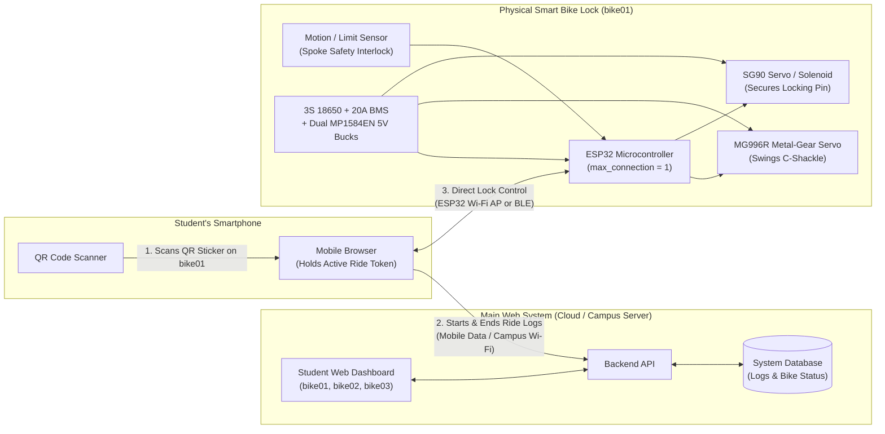
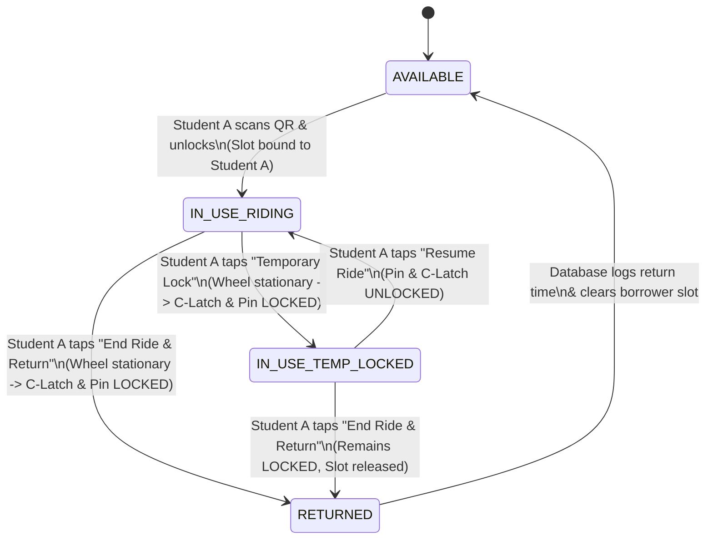
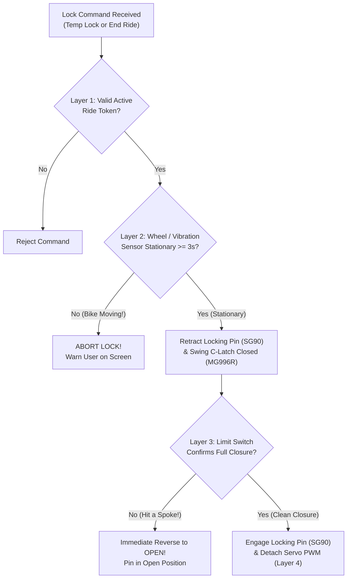

# Smart Bike Lock IoT System — Master Architecture & Hardware Handout

> [!IMPORTANT]
> **Core Project Scope & Operating Rules**
> 1. **Campus-Wide Operation:** Students can park and lock the bike **anywhere on campus** (not restricted to a single Wi-Fi router coverage zone).
> 2. **Mid-Ride Temporary Lock:** Students can **temporarily lock (pause)** the bike outside classrooms or buildings while keeping exclusive ownership of the bike session.
> 3. **Database Ownership:** The **ESP32 does not connect directly to the database**. All database writes and transaction logs are handled by the main **Web System Backend**, with the student's phone acting as the bridge between the Web System and the ESP32 hardware.
> 4. **Zero-Spoke-Hazard Guarantee:** The lock mechanism must **never** accidentally close while the bike is in motion, even if Wi-Fi disconnects or power fluctuates.

---

## 1. End-to-End System Architecture

Because bikes can be ridden and temporarily locked anywhere on campus (outside fixed router range), the system uses a **Phone-as-the-Bridge** architecture (via **ESP32 SoftAP with `max_connection = 1`** or **Web Bluetooth / BLE**).

### How the Two Communication Approaches Compare

| Feature | Approach A: ESP32 Wi-Fi Hotspot (`SoftAP`) + Browser Bridge | Approach B: ESP32 Web Bluetooth (`BLE`) + Mobile Data |
| :--- | :--- | :--- |
| **How Phone Connects to ESP32** | Student connects to `Bike01_Lock` Wi-Fi (`192.168.4.1`). | Browser connects directly via Bluetooth Low Energy (`navigator.bluetooth`). |
| **1-Device Limit** | Enforced via `WiFi.softAP(ssid, pass, 1, 0, 1)` (`max_connection = 1`). | Enforced by BLE single-peripheral connection + Ride Token. |
| **Proximity Requirement** | Must be within ~10–15m of the bike's ESP32 Wi-Fi. | Must be within ~2–5m of the bike's ESP32 Bluetooth. |
| **How Database Updates** | Phone loads Ride Token on Mobile Data/Campus Wi-Fi first $\rightarrow$ controls ESP32 over AP $\rightarrow$ ESP32 auto-disconnects Wi-Fi on Return so phone syncs back to Database. | Phone **never disconnects** from Mobile Data / Campus Wi-Fi; every button press (`Unlock`, `Temp Lock`, `Return`) updates the Database in real time. |

---

## 2. The 4-State Lock Lifecycle (Including Temporary Lock)

To ensure that a student can leave a bike **Temporarily Locked** outside a classroom without another student scanning the QR code and riding away with it, the system tracks **four distinct states**:

### State Behavior Table

| State | Physical C-Latch & Pin | Who Holds the 1 Slot? | What Happens if Another Student Scans the QR? |
| :--- | :--- | :--- | :--- |
| **1. `AVAILABLE`** | **LOCKED** (Closed & Pinned) | Nobody (`null`) | **Allowed.** System assigns the bike to the new borrower. |
| **2. `IN_USE (RIDING)`** | **UNLOCKED** (Open, Pinned Open, & Servo Detached) | **Student A** | **Blocked.** Dashboard shows `In Use`; ESP32 rejects any request without Student A's Ride Token. |
| **3. `IN_USE (TEMP LOCKED)`** | **LOCKED** (Closed & Pinned) | **Student A** *(Still owns the session!)* | **Blocked!** Even though the bike is parked and physically locked, Student A has not ended their ride. Only Student A can tap **Resume / Unlock**. |
| **4. `RETURNED`** | **LOCKED** (Closed & Pinned) | Cleared (`null`) | ESP32 disconnects Student A; phone sends final log to the Web System Database; bike resets to `AVAILABLE`. |

---

## 3. Step-by-Step Operational Walkthrough

### Phase 1: Borrowing the Bike
1. **Select Bike on Dashboard:** Student logs into the **Web System Dashboard** on their phone (using mobile data or campus Wi-Fi). The dashboard lists `bike01`, `bike02`, `bike03` and their current status.
2. **Scan Physical QR Code:** Student taps `bike01` $\rightarrow$ taps **"Scan QR Code to use this bike"** $\rightarrow$ scans the QR sticker mounted on `bike01`.
3. **Database Logs the Borrow Start:**
   * The Web System verifies `bike01` is `AVAILABLE`.
   * The Web System writes to the **Database**:
     * `bike_id`: `"bike01"`
     * `student_id`: `"2023-XXXXX"`
     * `status`: `"IN_USE"`
     * `time_started`: `"2026-11-21 10:00:00"`
   * The Web System generates a single-use **Ride Token** stored in the student's browser.
4. **ESP32 Unlocks:**
   * The student's phone connects to `bike01`'s ESP32 (`max_connection = 1`) and presents the **Ride Token**.
   * The ESP32 stores the Ride Token in non-volatile memory (`Preferences`), retracts the locking pin, swings the `MG996R` C-latch open $180^\circ$, engages the pin to lock the C-shackle in the open position, and detaches servo PWM.
   * The student rides away (no continuous Wi-Fi connection required while riding).

### Phase 2: Mid-Ride "Temporary Lock" (Anywhere on Campus)
1. **Park & Connect:** Student stops outside a campus building, reconnects to `bike01`'s ESP32 control screen, and taps **[⏸️ Temporary Lock (Pause Ride)]**.
2. **Spoke Safety Check:** The ESP32 verifies that the bike has been completely stationary for at least 3 seconds.
3. **Physical Lock:** The ESP32 retracts the pin, swings the `MG996R` C-latch closed, and pushes the locking pin into the closed C-shackle.
4. **Anti-Theft Session Protection:** The ESP32 sets its internal state to `TEMP_LOCKED` while **retaining Student A's Ride Token**. Nobody else can unlock `bike01`.
5. **Resume Ride:** When Student A returns, they tap **[🔓 Resume Ride]**. The ESP32 verifies Student A's Ride Token and opens the C-latch again.

### Phase 3: Final Return (Ending the Ride)
1. **Tap End Ride:** When finished, Student A parks the bike and taps **[🛑 End Ride & Return Bike]**.
2. **ESP32 Locks & Releases Slot:**
   * The ESP32 confirms the wheel is stationary, closes the `MG996R` C-latch, and engages the locking pin.
   * The ESP32 clears Student A's Ride Token, returns a signed **Return ReceiptPayload** (`bike_id`, `temp_lock_count`, `lock_confirmed = true`) to the phone browser, and **force-disconnects Student A from the ESP32 Wi-Fi AP** (freeing the 1 connection slot).
3. **Database Logs the Return:**
   * As soon as the phone drops off the ESP32 Wi-Fi, it automatically reconnects to Mobile Data / Campus Wi-Fi.
   * The browser sends the **Return ReceiptPayload** to the Web System Backend.
   * The Backend updates the **Database** (`time_returned`, `status = AVAILABLE`) and refreshes the dashboard.

---

## 4. Security & Safety Measures

### A. Preventing the "Pocket Auto-Reconnect" Slot Hijack (`max_connection = 1`)
> [!WARNING]
> **The Hidden Trap with `max_connection = 1`**
> If Student A borrows `bike01` on Monday, their phone saves `bike01`'s Wi-Fi network. If Student A walks near `bike01` on Tuesday with their phone in their pocket, their phone will **auto-reconnect** and occupy the single Wi-Fi slot, blocking Student B from connecting.

* **Fix 1 — Idle Auto-Kick Timer:** When any device connects to the ESP32 Wi-Fi AP, a 30-second countdown starts. If the device does not send a valid Ride Token command within 30 seconds, or once an `UNLOCK` / `TEMP_LOCK` / `RETURN` action finishes, the ESP32 disconnects the client (`esp_wifi_deauth_sta`) or puts the SoftAP to sleep until woken by a button press.
* **Fix 2 — Ride Token Binding:** Even if an unauthorized phone connects to the Wi-Fi, the ESP32 rejects every HTTP request that does not carry the active borrower's Ride Token.

### B. 4-Layer Spoke Protection (Preventing Accidental Lock While Riding)

1. **Layer 1 — State-Based Latching (Never Connection-Held):** Losing Wi-Fi signal while riding **never** triggers a lock. The ESP32 remains in `IN_USE_RIDING` indefinitely until an explicit lock command is sent.
2. **Layer 2 — Dual-Position Pinning (Mechanical Interlock):** Design the 3D-printed ABS housing so the locking pin (`SG90` / Solenoid) locks the C-shackle not only when **CLOSED**, but also when rotated $180^\circ$ **OPEN**. While pinned open, bumps and gravity physically cannot drop the C-shackle into the wheel spokes.
3. **Layer 3 — PWM Detach & Non-Volatile State (`Preferences`):** Once the C-latch reaches the open position and is pinned, the ESP32 calls `cLatchServo.detach()` (cutting the PWM signal so the servo cannot twitch) and saves `locked = false` in ESP32 flash memory (`Preferences.h`). If the ESP32 ever reboots mid-ride, it reads `locked = false` on startup and **does not move the servo**.
4. **Layer 4 — Motion & Obstruction Sensors:** An `SW-420` vibration sensor (or `MPU6050`) blocks any lock command while vibration is detected, and a micro limit switch verifies the C-latch closed cleanly without hitting a spoke before the locking pin engages.

---

## 5. Hardware Bill of Materials (`BOM1` & `BOM2`) Technical Review

Reference spreadsheet: [Smart Bike Lock BOM](https://docs.google.com/spreadsheets/d/1WcxUC2jRpCSK7Qq2vG8RRws-8gHCA0IBknZvJTJ4NBc/edit)

### Summary of Current Components (`BOM1` + `BOM2`)

| Item # | Category | Component & Specs | Qty | Price (₱) | Role in Smart Bike Lock & Engineering Verdict |
| :--- | :--- | :--- | :---: | :---: | :--- |
| **1** | Enclosure | Sunlu ABS Filament 1.75mm 1kg (Grey) | 1 spool | 659 | Weather- and impact-resistant 3D-printed housing for C-shackle, servos, and PCB. |
| **2** | Actuation (Pin) | Push-Pull Solenoid Actuator *(Ordered: 3V in BOM2)* **OR** `SG90` 9g Servo | 1 pc | 119 | **Use the `SG90` Servo workaround from `BOM2`!** (See Warning #1 below). |
| **3** | Actuation (C-Latch) | `MG996R` Metal-Gear High-Torque Servo ($180^\circ$, 13kg·cm) | 1 pc | 226 | Primary actuator that swings the C-latch open and closed. |
| **4** | Energy Storage | Rechargeable 18650 Li-Ion Cells (2200mAh, 3.7V) | 3 pcs | 152 | 3S configuration provides $11.1\text{V}$ nominal ($12.6\text{V}$ peak). |
| **5** | Energy Storage | 3-Slot 18650 Series Battery Holder (or 3D-printed holder) | 1 pc | 58 | Holds the 3 cells in series ($3\text{S}$). |
| **7** | Charging System | Smart Li-Ion Wall Charger ($12.6\text{V}$, $2\text{A}$) *(Check BOM2 4S note!)* | 1 pc | 149 | Dedicated CC/CV charger for the 3S battery pack. (See Warning #2 below). |
| **8** | Charging System | Panel-Mount Female DC Jack ($5.5 \times 2.1\text{mm}$) | 1 pc | 98 | External waterproof charging port on the ABS enclosure. |
| **9** | Voltage Regulation | DC-DC Buck Converter ($6\text{–}24\text{V}$ to $5\text{V}$ $3\text{A}$ USB/Terminal) | 1 pc | 33 | Step-down regulator option. |
| **10–12** | Solenoid Driver | `IRLZ44N` MOSFET + `1N4007`/`1N5819` Flyback Diode + $220\,\Omega$/$10\text{k}\Omega$ Resistors | 1 set | 298 | Required **only** if driving a solenoid coil. Not needed on the signal line if using `SG90` servo as the locking pin. |
| **13–18** | PCB & Assembly | FR4 Double-Sided PCB, `KF301` Terminal Blocks, 19P Female Headers (ESP32 socket), Male Headers, Jumper Kit, M3 Brass Heat-Set Inserts | 1 set | 662 | Solid permanent mounting platform so wires do not vibrate loose on the bike. |
| **19** | Battery Protection | 3S $11.1\text{V}$/$12.6\text{V}$ $20\text{A}$ BMS Protection Board | 1 pc | 40 | Prevents over-charge, over-discharge, and short circuits on the 3x 18650 pack. |
| **20** | Voltage Regulation | `MP1584EN` $3\text{A}$ Adjustable DC-DC Buck Converter | **2 pcs** | 78 | **Critical advantage:** Use Buck #1 for ESP32 ($5.0\text{V}$) and Buck #2 for the Servos ($5.0\text{V}\text{–}6.0\text{V}$). |

### Three Critical Hardware Action Items from `BOM2`

> [!CAUTION]
> **1. Do Not Run the 3V Solenoid on 11.1V (Use the `SG90` Workaround in `BOM2` Row 1)**
> `BOM2` notes that the ordered solenoid is the **3V variation** and suggests an **`SG90` (9g) servo** as a workaround. Driving a 3V solenoid from an 11.1V battery (or even 5V) will burn out the coil and drain your battery rapidly while held. **Use the `SG90` servo as your locking pin**—it runs off the exact same 5V servo buck converter as the `MG996R` and draws $0\text{mA}$ once moved into place.

> [!CAUTION]
> **2. Verify Charger Voltage (`3S 12.6V` vs. `4S 16.8V` in `BOM2` Row 5)**
> `BOM1` specifies 3x 18650 cells in series (**3S = 12.6V max**) with a **3S BMS**, while `BOM2` Row 5 lists `4S 1A (1 pc)`. A 4S charger outputs **$16.8\text{V}$**, which will trip a 3S BMS or overcharge 3S cells. Confirm that your charger output label reads **$12.6\text{V}$** (or use the External USB Power Bank workaround noted in `BOM2` Row 3).

> [!TIP]
> **3. Isolate the Dual `MP1584EN` Buck Converters & Add a ₱20 Motion Sensor**
> * **Dual Buck Isolation:** Before soldering the `MP1584EN` modules (Item #20), connect them to the 3S battery and turn their tiny potentiometer screws while measuring with a multimeter until both output **$5.0\text{V}$**. Wire **Buck #1 Output $\rightarrow$ ESP32 `VIN` (5V)**, and **Buck #2 Output $\rightarrow$ `MG996R` + `SG90` `VCC`**, with all `GND` pins connected together. This guarantees the `MG996R` startup spike never resets the ESP32.
> * **Recommended ₱20–₱65 Add-On:** Add an **`SW-420` Vibration Sensor (~₱20)** or **`MPU6050` Accelerometer (~₱65)** plus a **`KW11-3Z` Micro Limit Switch (~₱15)** to complete the 4-layer spoke-safety interlock.

---

## 6. Next Implementation Milestones

When you are ready to build, tackle these three milestones in order:
1. ✅ **Milestone 1 — Schematic, FR4 PCB Pinout & *I LOCK IT PRO* Horseshoe Blueprint:** Exact flat-out zero-overlap wiring schematic, verified 2-layer FR4 PCB layout, and mechanical internal blueprint for the ESP32, dual `MP1584EN` $5\text{V}$ buck converters, `3S 20A BMS`, `MG996R` curved C-shackle servo, `SG90` deadbolt pin servo, 3 status LEDs (Green/Yellow/Red), and piezo buzzer. *(Completed: see [milestone_1_schematic_and_pcb_pinout.md](file:///c:/Users/Yzhe%20Yu/Desktop/SMART%20BIKE%20LOCK%20PROJECT/milestone_1_schematic_and_pcb_pinout.md), [milestone_1_user_pcb_verified_and_completed.png](file:///c:/Users/Yzhe%20Yu/Desktop/SMART%20BIKE%20LOCK%20PROJECT/milestone_1_user_pcb_verified_and_completed.png), [milestone_1_flat_no_overlap_wiring.png](file:///c:/Users/Yzhe%20Yu/Desktop/SMART%20BIKE%20LOCK%20PROJECT/milestone_1_flat_no_overlap_wiring.png), and [milestone_1_ilockit_horseshoe_blueprint.png](file:///c:/Users/Yzhe%20Yu/Desktop/SMART%20BIKE%20LOCK%20PROJECT/milestone_1_ilockit_horseshoe_blueprint.png))*
2. ✅ **Milestone 2 — ESP32 Firmware (`.ino`):** Complete Arduino sketch implementing `max_connection = 1`, the 4 lock states (`AVAILABLE`, `IN_USE_RIDING`, `IN_USE_TEMP_LOCKED`, `RETURNED`), 3-LED feedback (`GPIO 21` Red, `GPIO 22` Yellow Park, `GPIO 23` Green Ride), sequential servo interlock (`GPIO 17` `MG996R`, `GPIO 18` `SG90`), and a built-in Hardware Bench Test Portal (`http://192.168.4.1`). *(Completed: see [smart_bike_lock_firmware.ino](file:///c:/Users/Yzhe%20Yu/Desktop/SMART%20BIKE%20LOCK%20PROJECT/smart_bike_lock_firmware/smart_bike_lock_firmware.ino))*
3. ✅ **Milestone 3 — Web Dashboard, QR Flow & Hardware Test Console:** Complete browser-based Student Web Dashboard & Hardware Bench Tester with live ESP32 bridge (`http://192.168.4.1`), interactive simulator fallback, and exportable Database Transaction Logs. *(Completed: see [web_dashboard/index.html](file:///c:/Users/Yzhe%20Yu/Desktop/SMART%20BIKE%20LOCK%20PROJECT/web_dashboard/index.html))*
